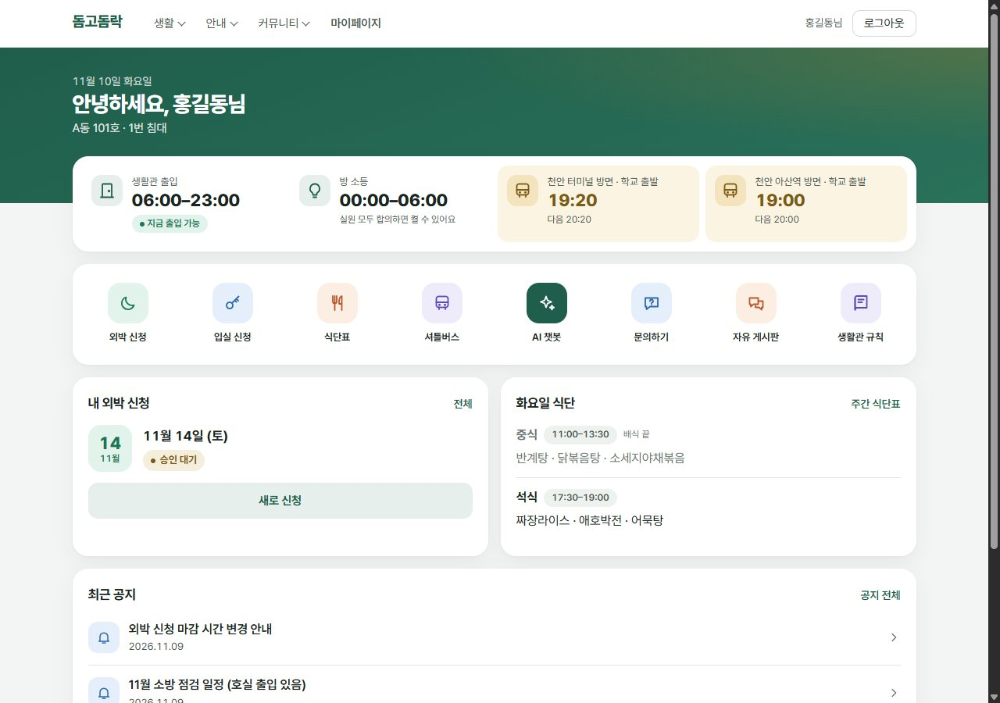
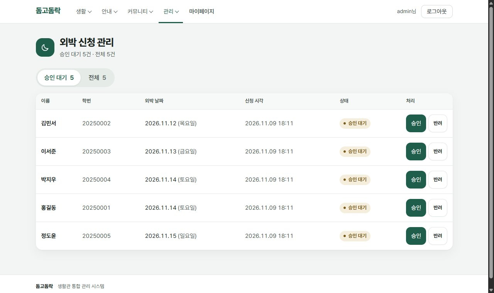
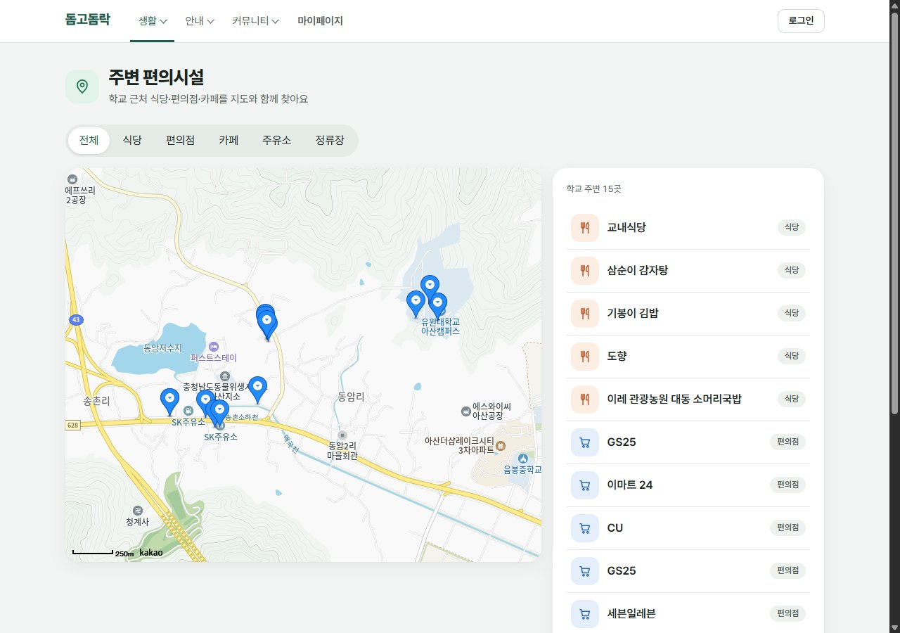
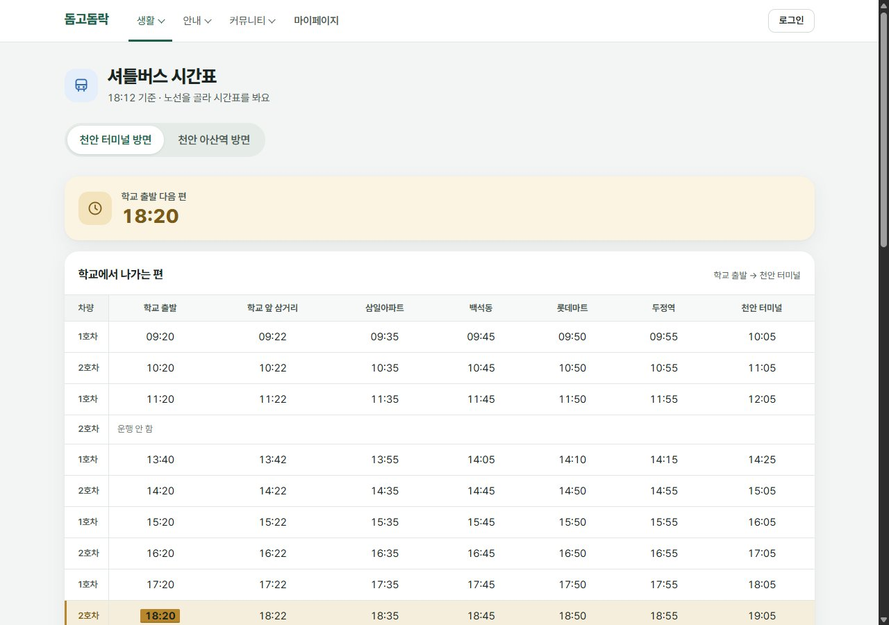
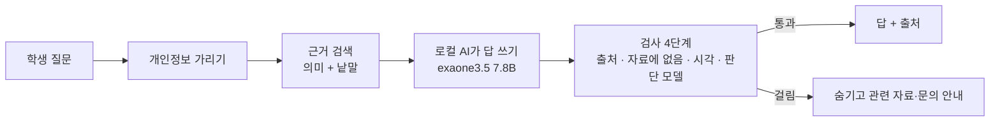
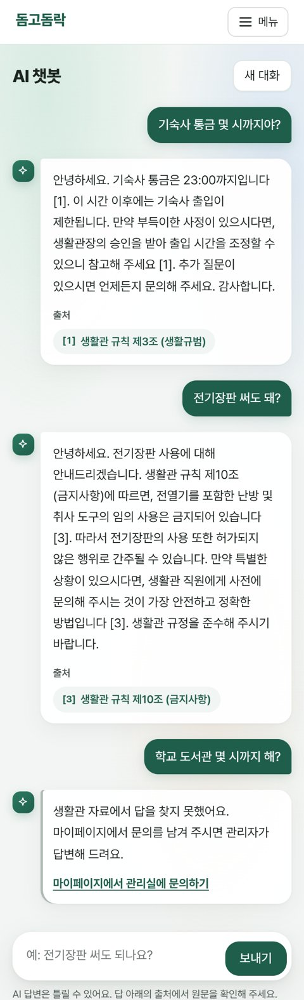
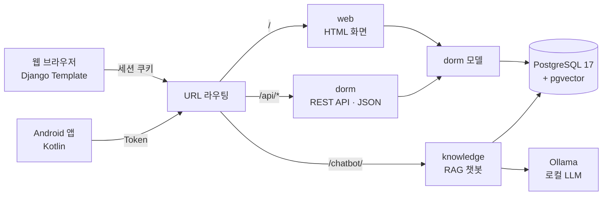

# 🏠 돔고돔락 (DORM苦DORM樂)

기숙사 생활을 웹과 Android 앱으로 함께 관리하는 통합 시스템입니다. 생활관 규칙·식단·셔틀에 답하는 **AI 챗봇(RAG)** 이 들어 있습니다.

[](https://github.com/ahcy205/Dorm_project/actions/workflows/test.yml)

| 테스트 | PR | 결정 기록(ADR) | 챗봇 사실 정확도 | 범위 밖 질문 거절 |
|---|---|---|---|---|
| 356개 (CI 자동 실행) | 96개 | 23개 | 0.96 | 100% |

---

## 📸 화면

| 홈 (학생) | 외박 신청 관리 (관리자) |
|---|---|
|  |  |
| **주변 편의시설 (카카오 지도)** | **셔틀버스 시간표** |
|  |  |

화면의 이름과 학번은 테스트용 예시 데이터입니다. 챗봇 화면은 [AI 챗봇](#-ai-챗봇-rag)에 있습니다.

---

## 📌 프로젝트 소개

- **누가 쓰나**: 기숙사생(학생)과 생활관 관리자
- **무엇을 하나**: 입실·외박 신청과 승인, 상벌점, 공지, 문의와 답변, 자유게시판, 식단·셔틀·주변 시설 안내, AI 챗봇
- **어떻게 만들었나**: 웹과 Android 앱이 Django 서버 하나와 DB 하나를 함께 씁니다. 웹은 화면(HTML), 앱은 REST API(JSON)로 요청합니다.
- **진행**: 팀 프로젝트로 시작했고, 종료 뒤 혼자 코드를 점검하며 보안·품질을 고치고 AI 챗봇과 새 화면을 더했습니다. 전 과정을 PR과 [변경이력](CHANGELOG.md)으로 남겼습니다.

---

## 🤖 AI 챗봇 (RAG)

생활관 자료에서 근거를 찾아 로컬 AI가 답을 쓰고, **여러 단계로 검사해서 확실한 답만 보여 줍니다.** 확실하지 않으면 지어내지 않고 숨긴 뒤 관련 자료와 문의 방법을 안내합니다.



<p align="center"><br>
<sub>실제 챗봇의 답: 통금·전기장판은 출처를 달아 답하고, 자료에 없는 도서관 질문은 지어내지 않고 거절</sub></p>

| 구성 | 내용 |
|---|---|
| 자료 | 생활관 규칙·안내·식단·셔틀·공지 (화면과 같은 YAML 원본을 공유) |
| 검색 | bge-m3 임베딩 + PostgreSQL pgvector 의미 검색과 낱말 검색을 합침. 학생 말을 규정 말로 보강("전기장판" → "전열기") |
| 답변 | Ollama로 이 PC에서 실행하는 exaone3.5:7.8b. 자료를 외부로 보내지 않음 |
| 검증 | 출처 번호 → "자료에 없음" 판정 → 시각이 근거의 같은 주제 줄에 있는지 → 판단 모델(Jev)이 "질문에 답했나, 근거와 어긋나나" 확인 |
| 셔틀 | AI 대신 시간표에서 직접 계산 (시각·방향 오답을 없앰) |
| 운영 | 대화는 개인정보를 가려 익명으로 180일 보관, 👍/👎과 못 답한 질문을 모아 평가 질문으로 씀 |

**정확도를 재고 올리는 방법**: 평가 질문 60개(답할 수 있는 50개 + 자료에 없는 10개)로 측정 → 숨겨지거나 틀린 답을 하나씩 읽고 원인 찾기 → 작게 고치기 → 다시 측정. 예를 들어 근거의 "06:00-23:00"을 "06:00부터 23:00까지"로 풀어 쓰니 통금 정답이 20번 중 8번에서 20번이 됐습니다.

| 지표 | 개선 전 | 지금 |
|---|---|---|
| 사실 정확도 | 0.87 ~ 0.91 | **0.96** |
| 잘못 거절 (답할 수 있는데 숨김) | 6 ~ 10% | **2 ~ 4%** |
| 범위 밖 질문 거절 (지어내지 않음) | 100% | **100%** |
| 첫 질문 응답 시간 (콜드 스타트) | 13초 | **3.5초** |

파인튜닝은 하지 않았습니다. 자료가 자주 바뀌고, 출처를 보여 주고 검사해야 해서 RAG가 맞다고 판단했습니다. 자세한 설계와 개선 과정은 **[챗봇 설계 문서](docs/chatbot.md)** 에 있습니다.

---

## 🛡️ 코드 점검과 개선 (팀 프로젝트 종료 후)

완성된 코드를 다시 점검해 **보안 취약점 7건**과 기능 오류를 찾아 고쳤습니다. 문제마다 실제 요청으로 재현하고, 실패하는 테스트를 먼저 쓴 뒤 고쳤습니다. 테스트는 0개에서 시작했습니다.

| 구분 | 발견한 문제 | 조치 | PR |
|---|---|---|---|
| 보안 | 로그인하지 않아도 다른 사람의 문의를 API로 열람 | 작성자·관리자만 조회하도록 권한 수정 | #9 |
| 보안 | 비로그인 사용자도 학생 상벌점 변경 가능 | 관리자 권한 검사 | #1 |
| 보안 | 외박 승인·댓글 삭제가 GET 링크로도 실행 | 상태를 바꾸는 요청은 POST만 허용 | #2 |
| 보안 | 이미지 칸에 스크립트가 든 HTML 파일 업로드 가능 | Pillow로 이미지 여부 검증 | #10 |
| 보안 | 다른 학생 명의로 외박 신청 가능 (웹·API) | 신청서 이름·학번을 로그인 계정과 대조 | #11 |
| 보안 | 관리자 검색으로 비밀번호 해시를 조건 검색 가능 | 검색 필드를 화면 항목으로 제한 | #12 |
| 보안 | 앱에서 로그아웃해도 Token이 계속 유효 | 로그아웃 API로 Token 삭제 | #35 |
| 설정 | `SECRET_KEY`가 공개 저장소에 노출 | 환경변수로 분리하고 키 교체 | #21 |
| 오류 | 웹 문의 등록이 저장되지 않음, 잘못된 입력에 500 에러(6곳) | POST 처리 추가, 저장 전 검증 | #3, #4, #13 |
| 성능 | 게시글 API가 글 20개에 쿼리 103번 (N+1) | `select_related`·`prefetch_related`·집계로 4번, 쿼리 수 테스트 | #33 |
| 데이터 | 외박 신청이 이름·학번 문자열로만 계정과 이어짐 | 외래키와 기존 데이터 연결 마이그레이션 | #27 |
| 구조 | 상단 메뉴·테마 코드가 템플릿마다 복사됨 | 공통 템플릿으로 분리(2,400여 줄 삭제), 화면 전후 비교로 검증 | #22, #23, #30 |
| DB | SQLite | PostgreSQL 17 + pgvector로 전환 (Docker) | #43 |
| 화면 | 템플릿마다 다른 디자인, Bootstrap·jQuery 혼용 | 디자인 기준을 정하고 전 화면 재작성, 외부 CSS·JS 라이브러리 제거 | #66~#86 |
| 개발 | 테스트가 자동으로 돌지 않음, API 사용법이 코드에만 있음 | GitHub Actions CI, Swagger 문서(`/api/docs/`) | #32, #38 |

---

## 🧭 시스템 구조



| 앱 | 역할 |
|---|---|
| `web` | HTML 화면 (Django Template) |
| `dorm` | 데이터 모델과 Android 앱용 REST API |
| `knowledge` | 원본 자료, 검색, 관리자용 답변 초안, 학생 챗봇, 평가 |

요청 처리 순서, 업무 흐름, 데이터 구조, 권한은 [흐름도](docs/flowchart.html)에 정리했습니다.

---

## 🛠 기술 스택

| 분야 | 사용 기술 |
|---|---|
| Backend | Python, Django 5.2, Django REST Framework, drf-spectacular (Swagger) |
| Database | PostgreSQL 17 + pgvector (Docker Compose) |
| AI | Ollama + exaone3.5:7.8b (답변), bge-m3 (임베딩), 하이브리드 검색, TypeSafe Jev (메시지 분류·답 검증) |
| Frontend | Django Template, 직접 작성한 CSS·JavaScript (외부 프레임워크 없음), Pretendard, 카카오 지도 JavaScript SDK |
| Mobile | Kotlin (Android) |
| DevOps | GitHub Actions CI, Docker. 팀 프로젝트 당시 AWS EC2 배포 (지금은 로컬 실행 전용, [ADR 0002](docs/adr/0002-local-only.md)) |

---

## 🔥 주요 기능

**학생**
- 회원가입·로그인, 마이페이지(내 정보, 상점·벌점, 문의와 답변)
- 입실 신청, 외박 신청과 결과 확인
- 오늘의 생활관: 출입·소등 시간, 다음 셔틀, 오늘 식단, 최근 공지
- 생활관 규칙·안내, 주간 식단표, 셔틀 시간표, 주변 편의시설 지도
- 자유게시판(익명, 댓글, 좋아요, 이미지), 공지사항
- AI 챗봇

**관리자**
- 입실 신청 방 배정, 외박 신청 승인·반려, 상벌점 부여, 학생 검색
- 문의 답변 (로컬 AI가 근거와 함께 답변 초안 작성)
- 공지 작성·수정

---

## 🧑‍💻 개발 방식

- **한 항목에 브랜치 하나, PR 하나**: 실패하는 테스트를 먼저 쓰고, CI가 통과해야 머지합니다 ([개발 규칙](CONTRIBUTING.md)).
- **결정은 기록**: DB, 검색, 모델 선택, 검증 방식처럼 중요한 결정은 이유와 측정 결과를 [ADR](docs/adr/)로 남깁니다. 시도했다가 나빠져서 버린 방법도 기록합니다.
- **화면 변경은 전후 비교**: [검증 도구](tools/README.md)로 화면 HTML과 캡처를 비교해 의도한 차이만 있는지 확인합니다.
- **AI 코딩 도구**: 팀 프로젝트 종료 뒤의 작업은 Claude Code와 함께 했고, 작업 규칙은 [CLAUDE.md](CLAUDE.md)에 있습니다.

---

## 💡 담당 역할

**팀 프로젝트**
- Django Template 기반 웹 프론트엔드와 화면 로직 개발, UI/UX 설계
- 팀원 간 개발 환경 차이로 생긴 오류 → Python·Django·DB 버전을 통일하고 EC2 서버 기준으로 통합 테스트
- 웹과 앱에서 같은 기능이 다르게 동작 → REST API 기준으로 데이터 구조와 로직을 하나로 맞춤

**종료 후 개인 작업**
- 보안·품질 점검과 수정, 테스트·CI 구축
- PostgreSQL + pgvector 전환, RAG 챗봇과 관리자 답변 초안 설계·구현·평가
- 화면 디자인 기준 수립과 전 화면 재작성

---

## ▶️ 로컬 실행

```bash
docker compose up -d db              # PostgreSQL + pgvector (Docker Desktop 필요)
python -m venv venv
venv\Scripts\activate                # macOS/Linux: source venv/bin/activate
pip install -r requirements.txt
python manage.py migrate
python manage.py createsuperuser     # 관리자 계정 (선택)
python manage.py runserver           # 8000이 사용 중이면 127.0.0.1:8001
```

- 웹 http://127.0.0.1:8000/ · 앱용 API `/api/` · API 문서 `/api/docs/`
- 테스트: `python manage.py test web dorm knowledge` (DB가 켜져 있어야 함)
- **AI 챗봇과 답변 초안** (선택)
  1. `pip install -r requirements-ml.txt` (임베딩 모델)
  2. [Ollama](https://ollama.com) 설치 후 `ollama pull exaone3.5:7.8b`
  3. `python manage.py build_knowledge_index` (검색 자료 만들기)
  4. 챗봇: `/chatbot/` (로그인 필요). 판단 모델 Jev는 환경변수 `TYPESAFE_API_KEY`가 있을 때만 쓰고, 없으면 검사 1~3단계만으로 동작합니다.
  5. 평가: `python manage.py evaluate_knowledge_search` (검색), `python manage.py evaluate_answer_drafts --mode chat` (챗봇)
- **환경변수**
  - `DJANGO_SECRET_KEY`: 로컬(`DEBUG=True`)에서는 없어도 실행됩니다.
  - `KAKAO_MAP_KEY`: 카카오 개발자 콘솔의 JavaScript 키. "JavaScript SDK 도메인"에 접속 주소(예: `http://127.0.0.1:8000`)를 등록하고, 카카오맵 사용 설정을 켜야 합니다. 없으면 지도 대신 안내 문구와 목록이 나옵니다.
- DB가 꺼져 있으면 `PostgreSQL에 접속할 수 없습니다` 안내가 나옵니다. Docker Desktop을 켜고 `docker compose up -d db`를 실행하세요.
- 로컬 실행 기준입니다. 배포용 설정(`DEBUG=False`, 허용 호스트·CORS 제한)은 적용하지 않았습니다.

---

## 📄 문서

- [🤖 챗봇 설계와 정확도](docs/chatbot.md) — 답을 만드는 흐름, 틀린 답을 막는 검사 4단계, 정확도를 재고 올리는 방법
- [🧭 결정 기록 (ADR)](docs/adr/) — DB, 검색, 모델, 검증 방식 등 주요 결정과 이유·측정
- [🗺️ 흐름도](docs/flowchart.html) — 시스템 구조, 업무 흐름, 데이터 구조, 권한 (내려받아 브라우저로 열기)
- [📝 변경이력](CHANGELOG.md)
- [🧑‍💻 개발 규칙](CONTRIBUTING.md) · [AI 작업 규칙](CLAUDE.md)
- [🔍 검증 도구](tools/README.md) — 화면 전후 비교
- [📘 결과보고서](docs/결과보고서.pdf) · [📑 화면정의서](docs/화면정의서.pdf) (팀 프로젝트 당시)
