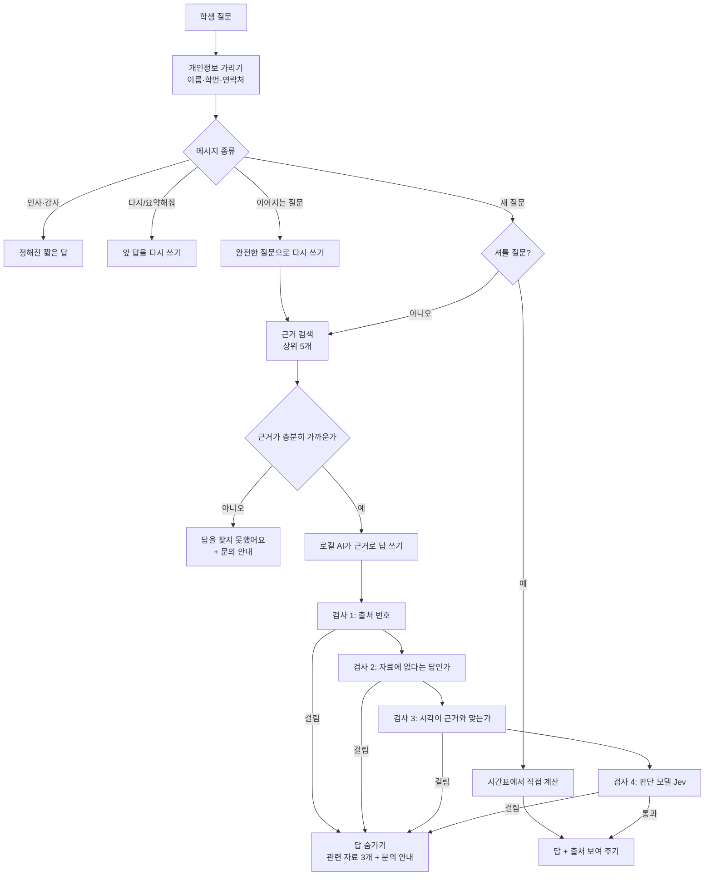
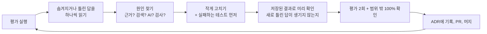

# 학생 챗봇: 설계와 정확도를 올리는 방법

생활관 규칙·안내·식단·셔틀·공지를 근거로 학생 질문에 답하는 챗봇입니다. 이 문서는 챗봇이 **어떻게 답을 만들고**, **어떻게 틀린 답을 막고**, **정확도를 어떻게 재고 올리는지**를 쉽게 정리합니다. 결정 하나하나의 자세한 이유와 측정은 [ADR](adr/)에 있습니다.

## 한 줄 요약

> 생활관 자료에서 근거를 찾아 로컬 AI가 답을 쓰고, 여러 단계로 검사해서 **확실한 답만 보여 줍니다.** 확실하지 않으면 지어내지 않고 숨긴 뒤 관련 자료와 문의 방법을 안내합니다.

## 1. 답을 만드는 흐름



### 단계별 설명

| 단계 | 하는 일 | 왜 이렇게 했나 |
|---|---|---|
| **자료** | 규칙·안내·식단·셔틀은 `knowledge/data/*.yaml` 하나를 화면과 챗봇이 같이 씁니다. 조항 하나, 하루 식단 하나가 근거 한 조각입니다. 공지도 조각이 됩니다. | 화면과 챗봇 내용이 어긋나지 않게 ([ADR 0011](adr/0011-student-chatbot.md)) |
| **개인정보 가리기** | 질문 속 이름·학번·전화번호·이메일을 `[학번]`처럼 바꿉니다. | 외부 판단 모델과 기록에 개인정보가 남지 않게 |
| **메시지 종류 판단** | 인사 / "다시 말해줘" / 이어지는 질문 / 새 질문을 Jev가 구분합니다. | 인사에 규칙을 검색하거나, "그럼 주말은?"을 앞 대화 없이 검색하는 일을 막기 위해 ([ADR 0014](adr/0014-chatbot-conversation-and-router.md), [0016](adr/0016-chatbot-followup-rewrite.md)) |
| **셔틀 질문** | AI에게 맡기지 않고 시간표에서 다음 차 시각을 계산합니다. | AI가 시각·방향을 자주 틀려서 ([ADR 0017](adr/0017-bus-answers-from-timetable.md)) |
| **근거 검색** | 의미 검색(bge-m3, pgvector)과 낱말 검색을 합쳐 5개를 찾습니다. "전기장판 → 전열기"처럼 학생 말을 규정 말로 보강해서 찾습니다. | 학생 말과 규정 말이 달라도 찾게 ([ADR 0006](adr/0006-embedding-model-and-hybrid-search.md), [0009](adr/0009-query-synonyms.md)) |
| **근거가 약하면 멈춤** | 가장 가까운 근거의 유사도가 0.45보다 낮으면 AI를 부르지 않습니다. | 자료에 없는 질문에 지어낸 답을 막기 위해 ([ADR 0007](adr/0007-local-llm-answer-draft.md)) |
| **답 쓰기** | 이 PC의 Ollama에서 exaone3.5:7.8b가 근거만 보고 답하고, 문장마다 `[1]`처럼 출처를 답니다. | 외부로 자료를 보내지 않고, 출처로 확인할 수 있게 ([ADR 0008](adr/0008-answer-draft-llm-choice.md), [0010](adr/0010-draft-prompt-examples.md)) |

### 답을 쓰기 전에 근거를 다듬는 것

AI는 근거 글을 그대로 받으면 헷갈리는 곳이 있었습니다. 그래서 AI에게 보내는 글만 조금 바꿉니다. 저장된 원문과 화면은 그대로입니다.

| 다듬는 것 | 예 | 막은 오류 |
|---|---|---|
| 학생 말 ↔ 규정 말 알려 주기 | "질문의 '전기장판'은 근거의 '전열기'에 해당합니다." | "명시되어 있지 않지만…"으로 말을 돌림 ([ADR 0022](adr/0022-hedged-answers.md)) |
| 시각 범위 풀어 쓰기 | "06:00-23:00" → "06:00부터 23:00까지" | "통금은 06:00까지" ([ADR 0023](adr/0023-spell-time-ranges.md)) |
| 벌점표 항목 번호 빼기 | "12. 무단 외박: 7점" → "- 무단 외박: 벌점 7점" | 번호를 출처 `[12]`나 점수 "18점"으로 읽음 |
| 요일을 물으면 그 요일 식단만 | "수요일 점심" → 수요일 식단만 근거로 | 다른 요일 내용을 섞음 |

## 2. 틀린 답을 막는 검사 4단계

모든 검사를 통과한 답만 학생에게 보입니다. 하나라도 걸리면 답을 숨기고, 관련 자료 링크와 "마이페이지에서 문의"를 안내합니다.

1. **출처 번호 검사**: 출처가 없거나, 없는 번호(근거는 5개인데 `[12]`)를 달았으면 숨깁니다.
2. **"자료에 없다" 검사**: 답의 앞 두 문장이 "명시되어 있지 않습니다"로 끝나면 숨깁니다. 다만 "명시되어 있지 않지만, 제10조에서 금지합니다 [3]"처럼 말을 이어 가며 답한 경우는 다음 검사로 넘깁니다 ([ADR 0022](adr/0022-hedged-answers.md)).
3. **시각 검사**: 답의 시각이 근거의 **같은 주제 줄**에 있는지 규칙으로 봅니다. 출입시간 23:00을 "23:00 소등"처럼 다른 주제에 붙이면 숨깁니다. 질문과 관계없이 덧붙인 틀린 문장만 걸리면 그 문장만 빼고 다음으로 넘깁니다 ([ADR 0019](adr/0019-time-topic-check.md)).
4. **판단 모델(Jev) 검증**: 외부 판단 전용 모델에게 "질문에 실제로 답하는가", "근거와 어긋나는 사실(시간·숫자·허용 여부)이 있는가"를 묻습니다 ([ADR 0015](adr/0015-chatbot-answer-verification.md)).

**설계 원칙: 틀린 답보다 숨긴 답이 낫다.** 기숙사 규칙을 틀리게 알려 주면 학생이 벌점을 받을 수 있습니다. 그래서 확실하지 않으면 숨기고, 숨긴 비율("잘못 거절")은 줄이는 대상으로 따로 잽니다.

## 3. 정확도를 재는 방법

평가 질문은 직접 쓴 것과 실제로 못 답한 질문에서 모읍니다.
- `knowledge/eval/questions.yaml`: 답할 수 있는 질문 50개, 범위 밖 질문 10개
- 실제 기록에서 모으기: `export_chat_misses` 명령이 챗봇이 못 답한 질문과 👎 받은 답을 평가 후보로 뽑습니다 ([ADR 0012](adr/0012-chat-log-anonymous.md)).

| 지표 | 뜻 | 목표 |
|---|---|---|
| **사실 정확도** | 학생에게 보인 답에 꼭 있어야 할 사실(예: "23:00", "7점")이 있는 비율 | 높게 |
| **잘못 거절** | 답할 수 있는 질문인데 숨긴 비율 | 낮게 |
| **범위 밖 거절** | "도서관 몇 시까지?"처럼 자료에 없는 질문을 지어내지 않고 거절한 비율 | 항상 100% |
| 정답 근거 인용 | 맞는 조항을 출처로 단 비율 | 높게 |
| 검색 hit@5 | 맞는 근거가 검색 상위 5개 안에 드는 비율 | 100% |

```
python manage.py evaluate_knowledge_search            # 검색만 (빠름, 무료)
python manage.py evaluate_answer_drafts --mode chat   # 학생 챗봇 전체 (Ollama + Jev, 약 7분)
```

## 4. 정확도를 올리는 방법

한 번에 하나씩 이 순서로 고칩니다.



자주 쓰는 요령:
- **원인은 대개 AI가 아니라 근거 쪽에 있습니다.** 모델을 바꾸기 전에 근거 글이 헷갈리게 적혀 있지 않은지 먼저 봅니다. 예: "즐거운 / 주말 / 되세요 ^^"가 금요일 석식 칸에 메뉴처럼 들어 있었습니다.
- **숨긴 답이 정말 틀렸는지 확인합니다.** 숨긴 답의 상당수는 실제로 틀린 답이었습니다. 그런 답은 숨기는 게 맞으므로 검사를 느슨하게 하지 않습니다.
- **비싼 평가 전에 싸게 확인합니다.** 판단 모델 없이 같은 질문을 10~20번 물어 고치기 전후를 비교합니다(예: 통금 8/20 → 20/20). 저장된 평가 결과에 새 규칙을 먼저 적용해 봅니다.
- **AI는 같은 질문에도 매번 조금 다르게 답합니다**(temperature 0.2). 그래서 평가는 2회 이상 돌리고, 같은 날 바꾸기 전 코드와 비교합니다.
- **해 보고 나빠진 방법도 기록합니다.** 예: 근거에서 질문과 가까운 줄을 표시하는 방법은 측정에서 나빠져 쓰지 않습니다([ADR 0018](adr/0018-evidence-line-mark-rejected.md)).

## 5. 지금까지의 결과

최근 개선 (2026-11-05, 같은 50+10개 질문, 평가 2회씩)

| 고친 것 | 효과 |
|---|---|
| 금요일 석식 데이터 정리, 요일 질문엔 그 요일 식단만 (#91, #92) | 금요일 저녁·수요일 점심 정답 |
| 질문과 관계없이 덧붙인 틀린 문장만 빼기 (#92) | 신입생 질문 0/2 → 2/2 보임 |
| 시각 범위 풀어 쓰기 (#93) | 통금 정답 8/20 → 20/20 |
| 벌점표 번호 빼기 (#94) | 벌점 질문 33/40 → 40/40 |
| 환불 공지 추가, 정직한 안내는 숨기지 않기 (#95) | 환불 질문 답이 보이게 됨 |

| | 이날 처음 | 지금 |
|---|---|---|
| 사실 정확도 | 0.87 ~ 0.91 | **0.96 / 0.96** |
| 잘못 거절 | 6 ~ 10% | **4% / 2%** |
| 범위 밖 거절 | 100% | **100%** |

## 6. 남은 한계

- AI가 가끔 근거에 없는 조건을 지어냅니다(예: "봉사 감면은 20점 미만일 때만"). 판단 모델이 숨겨서 학생에게 보이지는 않지만 답이 사라집니다.
- 생활관비 환불 기준표가 원본 자료에 없습니다. 2024년 1학기 모집 공지에서 찾은 두 가지(식비 환불 없음, 입소 후 3/4 이후 관리비 환불 없음)만 출처를 붙여 넣었습니다.
- 판단 모델(Jev)은 외부 서비스입니다. 쓸 수 없으면 검사 1~3만으로 동작합니다.

## 7. 코드 위치

| 파일 | 역할 |
|---|---|
| `knowledge/data/*.yaml` | 원본 자료 (화면과 공용) |
| `knowledge/chunking.py` | 자료를 근거 조각으로 나누기 |
| `knowledge/search.py` | 근거 검색, 학생 말 보강 |
| `knowledge/answering.py` | 근거 고르기·다듬기, 프롬프트, AI 호출 |
| `knowledge/chat.py` | 챗봇 흐름, 검사 1·2, 덧붙인 문장 빼기 |
| `knowledge/time_check.py` | 검사 3 (시각) |
| `knowledge/verify.py` | 검사 4 (Jev) |
| `knowledge/router.py`, `conversation.py` | 메시지 종류, 이어지는 질문 |
| `knowledge/bus_answer.py` | 셔틀 시간표 답 |
| `knowledge/eval/` | 평가 질문과 결과 |
